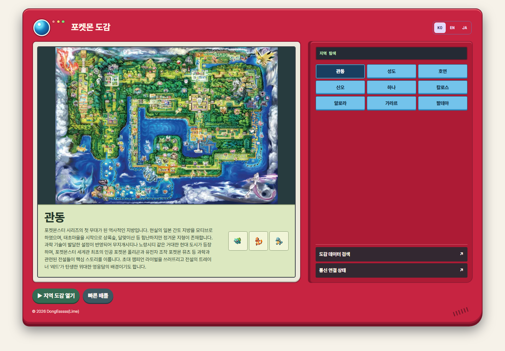
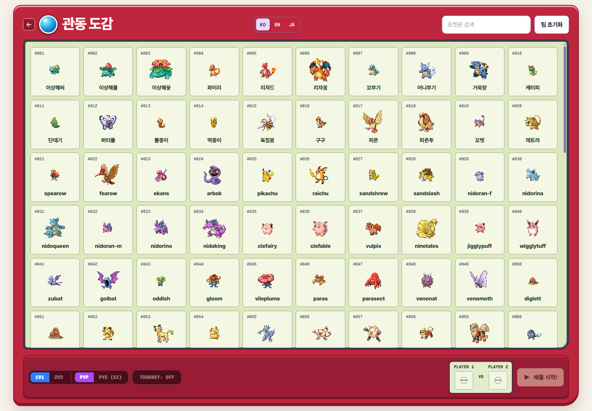
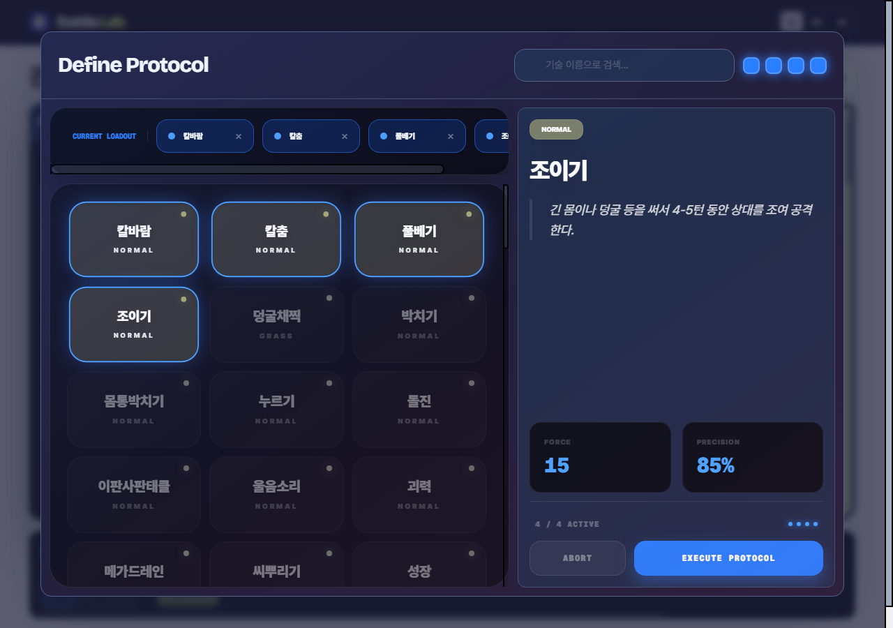
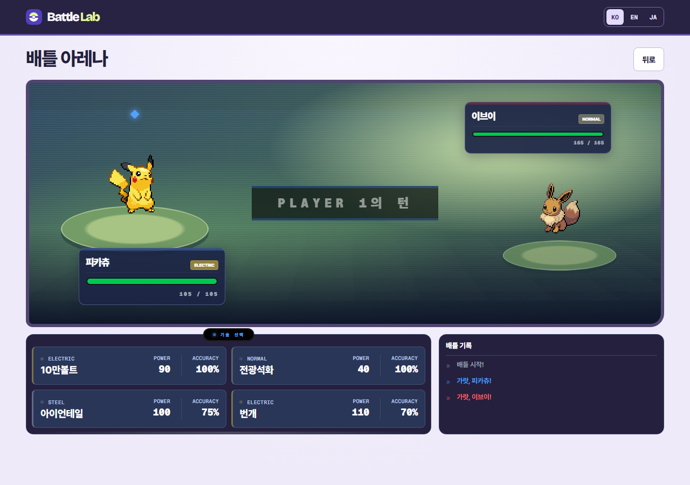
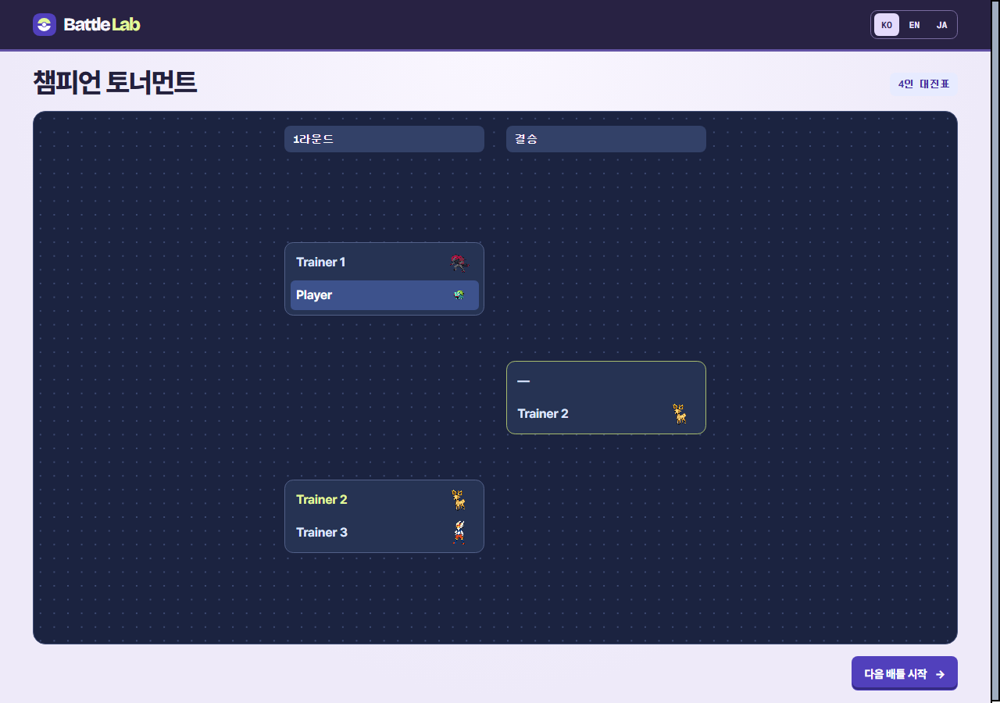

# 포켓몬 배틀 시뮬레이터 (Pokemon Battle Simulator)

PokeAPI를 사용하여 포켓몬 정보를 조회하고 배틀 시뮬레이션을 진행할 수 있는 웹 프로젝트입니다. 
휴대용 게임기에서 영감을 얻은 화면과 다국어 기능을 지원합니다.

## 실행

Node.js 24와 npm이 필요합니다.

```bash
npm ci
npm run dev
```

[로컬 홈 화면](http://localhost:3000)에서 **빠른 배틀**을 누르면 피카츄로 이브이 AI와 1대1 대전을 시작할 수 있습니다. 팀과 기술을 직접 구성하려면 지역을 선택하세요. 포켓몬과 기술 데이터를 불러오려면 인터넷 연결이 필요합니다.

```bash
npm test       # 배틀 규칙 테스트
npm run build  # 프로덕션 빌드
```

## 📋 프로젝트 개요 (Project Overview)

*   **개발 형태**: 1인 프로젝트 (Vibe coding)
*   **담당 역할**: 기획, UI/UX 디자인, 프론트엔드 개발, 시뮬레이션 로직 구현
*   **개발 기간**: 2026.04.24 ~ 2026.05.27 (약 5주)
*   **주요 목표**: PokeAPI를 활용한 실시간 데이터 연동 및 터미널 감성의 사용자 경험 제공

## 📸 주요 화면 (Screenshots)

<table align="center">
  <tr>
    <td align="center"><b>포켓몬 도감 홈</b><br/></td>
    <td align="center"><b>지역 도감과 팀 편성</b><br/></td>
  </tr>
  <tr>
    <td align="center"><b>커스텀 기술 로드아웃</b><br/></td>
    <td align="center"><b>배틀 시뮬레이션</b><br/></td>
  </tr>
  <tr>
    <td colspan="2" align="center"><b>토너먼트 대진표</b><br/></td>
  </tr>
</table>

## 🛠 주요 기능

*   **빠른 배틀**은 별도의 팀 구성 없이 홈에서 바로 AI전에 진입합니다.
*   **배틀 시뮬레이션**은 1대1과 2대2, 같은 기기에서 하는 PvP와 AI전을 지원합니다. 기술 명중률, 타입 상성, 상태이상, 쓰러진 포켓몬의 교체를 처리하고 결과를 배틀 로그에 표시합니다.
*   **토너먼트**는 4·8·16·32인 대진표에서 AI 상대와 대전할 수 있습니다. 대진표를 불러오지 못하면 다시 시도할 수 있습니다.
*   **지역 도감과 통합 검색**은 포켓몬과 기술 데이터를 조회합니다. 지역 도감은 목록부터 보여주고 번역된 이름을 차례로 채웁니다.
*   **기술 편집**은 포켓몬마다 사용할 기술을 최대 4개까지 선택할 수 있습니다.
*   **Neural-Link (속도 측정)**: 실제 API 서버와의 통신 상태를 체크하는 대기 시간 및 다운로드 속도 측정 기능
*   **다국어 지원 (i18n)**: 한국어(Pretendard), 영어, 일본어 지원 (각 언어별 최적화된 폰트 적용)
*   **반응형 레이아웃**은 데스크톱과 모바일에 맞춰 지역 메뉴, 기술 버튼, 배틀 로그를 배치합니다.

## 💻 기술 스택

*   **Frontend**: Next.js (App Router), TypeScript, Tailwind CSS
*   **Font System**: Pretendard Variable, Bricolage Grotesque, Geist Mono
*   **Internationalization**: react-i18next
*   **API Interface**: PokeAPI (Official v2)

